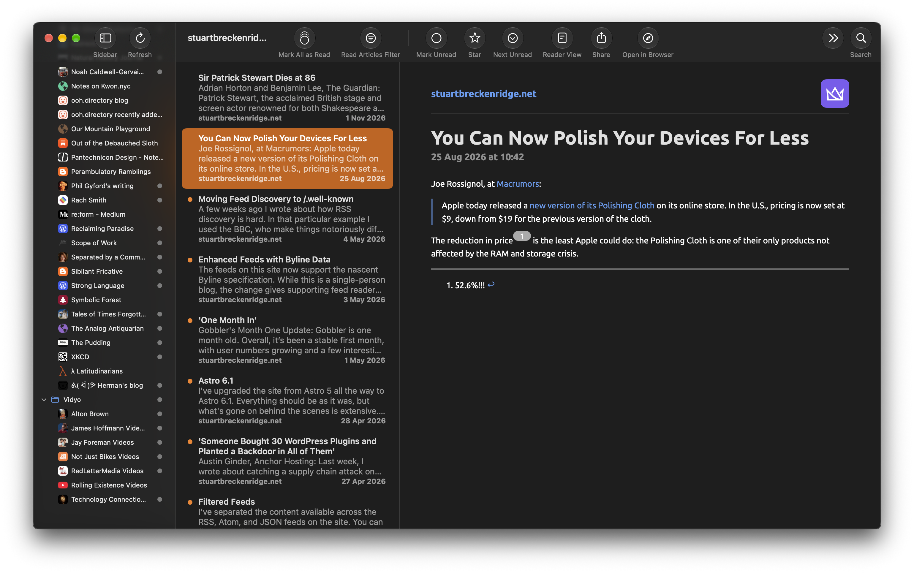

# NetNewsWire-Themes
Themes I created custom for my the NetNewsWire RSS client.

To use any of these themes, I recommend either cloning this repo or downloading it as a zip file.
Click the green `Code` button in the upper right of this repo, and select "Download ZIP". Unzip
the zip file, and you should now be able to copy themes into the NetNewsWire theme directory. You
can easily open that directory in NewNewsWire via the `NetNewswire` menu bar item > `Preferences` >
`Open Themes Folder`. Copy and paste the .netnewswire directory in there and voila! themes should
be available in the app dropdown.

## Ubuntu

This is the default theme, but it uses Canonical's [Ubuntu font family](https://design.ubuntu.com/font/) for text, titles, and code.
Personally I like the default theme's styling just fine, but the San Francisco font isn't particularly pleasing to my eye.
This replaces all San Francisco font types with Ubuntu font types. Be sure to install the Ubuntu font family before you install this,
or it'll end up falling back to... less pleasant fonts.

## Compact

For people who want even smaller text than most NetNewsWire themes allow, and no margins. Created specifically for my iPhone 13 mini, though anyone who likes small-ish text could benefit on any iOS device. Also turns links and headings a lovely shade of orange instead of that nasty blue everyone else seems fine with in the default theme.

